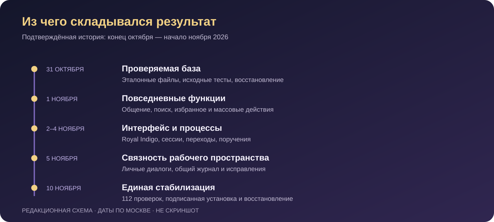
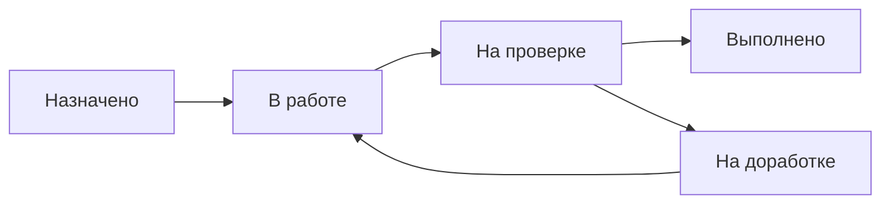

**История разработки • Реальный интерфейс • Проверяемые результаты**

# Кадет-Диск
### Как идея общего пространства для файлов превратилась в самостоятельное Windows-приложение

Документы, переписка, поручения, календарь и обновления — за привычными кнопками скрывается история восстановления, проверки прав, сетевых сбоев и постепенного взросления продукта.

**Редакция от 10 ноября 2026 года** · Большой иллюстрированный разбор

> **О достоверности.** Это обезличенная история по материалам разработки и сохранённым свидетельствам выпусков. Скриншоты настоящие: они получены при тестовых запусках собранного приложения. Конфиденциальные участки закрыты непрозрачными масками. Схемы и обложка — редакционные иллюстрации, а не снимки интерфейса. Статья не раскрывает участников, контекст внедрения, рабочие документы или инфраструктурные адреса.

---

## Навигация

1. [Идея: собрать работу вокруг документа](#1-идея-собрать-работу-вокруг-документа)
2. [Начало истории и восстановление проверяемой базы](#2-начало-истории-и-восстановление-проверяемой-базы)
3. [Хронология: от базы к стабилизации](#3-хронология-от-базы-к-стабилизации)
4. [Реальный дизайн и устройство приложения](#4-реальный-дизайн-и-устройство-приложения)
5. [Файлы: гораздо больше, чем список названий](#5-файлы-гораздо-больше-чем-список-названий)
6. [Общение, поручения и календарь](#6-общение-поручения-и-календарь)
7. [Архитектура: три части одной системы](#7-архитектура-три-части-одной-системы)
8. [Трудности, которые определили решения](#8-трудности-которые-определили-решения)
9. [Как измеряли скорость](#9-как-измеряли-скорость)
10. [Проверки, сборка и безопасное обновление](#10-проверки-сборка-и-безопасное-обновление)
11. [Работающий результат и его границы](#11-работающий-результат-и-его-границы)
12. [Что эта история говорит о разработке](#12-что-эта-история-говорит-о-разработке)

---

## 1. Идея: собрать работу вокруг документа

У «Кадет-Диска» понятная продуктовая идея: предоставить пользователю одно приложение, в котором можно найти нужный файл, обсудить его, увидеть связанное поручение и вернуться к работе через уведомление. Документ здесь становится частью процесса, а не отдельной записью в облачном каталоге.

Обычное файловое хранилище отвечает на вопрос «где лежат байты». Для совместной работы нужны и другие ответы. Кто имеет право открыть документ? Какая версия была передана на ознакомление? Кто уже подтвердил её получение? Что изменилось после последнего входа? Можно ли продолжить скачивание после обрыва связи?

Из этих вопросов выросли основные направления продукта:

- доступные пользователю общие и личные папки;
- поиск и повседневные действия с документами;
- сообщения, упоминания и вложения;
- поручения, сроки и подтверждение ознакомления;
- календарь, события и уведомления;
- управляемое обновление Windows-клиента.

Это описание назначения системы, восстановленное по её функциям. Оно не является пересказом неизвестной первой встречи или выдуманного разговора об идее. Точная дата самого первого замысла доступными материалами не установлена.

**Отправная точка истории — задача объединить файлы и действия вокруг них, сохранив понятный интерфейс и проверяемые границы доступа.**

## 2. Начало истории и восстановление проверяемой базы

История программного продукта редко начинается с идеально оформленного репозитория. В случае «Кадет-Диска» важным этапом стало восстановление связи между исходниками, установленным приложением и работающим сервером.

В исторической базе сохранились клиентские исходники поколения 1.2 и серверные материалы поколения 1.3. При этом наличие папки с номером версии ещё не доказывало, что именно из неё собран установленный клиент. Материалы восстановления прямо фиксировали это ограничение.

31 октября 2026 года была подготовлена контрольная точка: сверены набор, размеры и контрольные суммы **337 файлов** установленного эталона. Несовпадений не найдено. Базовый набор синтетических проверок дал **16 успешных тестов**. Эти результаты подтверждали состояние базы для дальнейшей работы; они не означали, что будущий новый клиент уже готов.

Так появился принцип, важный для всей последующей истории: сначала установить, что именно известно, затем менять продукт. Историческая копия, восстановленный исходник, тестовый кандидат и опубликованный выпуск должны оставаться различимыми.

В начале ноября работа продолжилась объединением функциональных исправлений с тёмной оболочкой. Возвращалась воспроизводимая сборка клиента, сохранялась совместимость с сервером, последовательно добавлялись возможности библиотеки документов и общения.

Это была эволюция существующей системы. Её ценность состояла в сохранении накопленных данных и поведения при переходе к более целостному приложению.

## 3. Хронология: от базы к стабилизации

*Редакционная хронология по датированным материалам. Она показывает этапы подтверждённой истории, а не дату возникновения самой идеи.*

| Период, МСК | Подтверждённый этап | Что он изменил |
|---|---|---|
| До контрольной точки 31 октября | Уже существовали клиент, сервер и установленное приложение | Развитие начиналось с работающей базы, которую предстояло точно сопоставить с исходниками |
| 31 октября | Аудит и подготовка восстановления | Проверены эталонные файлы и исходные тесты; обозначены ограничения эквивалентности |
| 1 ноября | Последовательные функциональные выпуски | Реакции и эмодзи, избранное, недавние открытия, поиск по содержимому и массовые действия |
| 2 ноября | Исправления сессий и развитие Royal Indigo | Работа с сохранённым устройством стала надёжнее; оформлялась новая общая оболочка |
| 3–4 ноября | Оптимизация переходов и опубликованный этап 3.0 | Прямой переход от события к файлу, развитие поручений, подтверждений и календарных уведомлений |
| 5 ноября | Этап 3.5 и последующие корректировки | Личные переписки, общий журнал с фильтрацией доступа, история календаря, уведомления и исправления |
| Ночь на 10 ноября | Единый стабилизационный выпуск, техническая версия 4.1 | 112 проверок, проверенное обновление, резервирование и адресные исправления основных сценариев |

Номера в этой таблице — исторические технические обозначения. Название продукта в статье и актуальных материалах — **«Кадет-Диск»**.

Хронология особенно хорошо показывает смену акцента. Сначала важно вернуть проверяемую основу и собрать совместимый клиент. Затем — сделать ежедневные действия удобнее. Позже внимание всё больше занимают жизненный цикл сессии, повторные сетевые операции, сохранение данных и корректность обновления.

## 4. Реальный дизайн и устройство приложения

*Реальный снимок собранного приложения из тестового сценария этапа 3.0, 4 ноября. Числа и документ — синтетические. Верхняя полоса с идентифицирующей символикой и подписью, а также конфиденциальная подпись события закрыты. Состояние «Нет соединения» сохранено как на исходном снимке.*

У интерфейса есть узнаваемый визуальный характер: тёмный индиго, фиолетовые активные элементы, светлый текст и золотистые акценты. Эта тема получила в материалах разработки название **Royal Indigo**.

Но история дизайна не сводилась к смене цветов. Главная страница собирала несколько разных задач в одном месте: обзор документов, поручений и событий, последние изменения, ближайшие сроки и быстрые действия. Пользователю не требовалось начинать каждый сеанс с обхода всех разделов.

Левая навигация отделена от дерева папок. Разделы приложения остаются на постоянных местах, а файловое дерево относится к файловой работе. Такое разделение важно: переход в календарь не должен восприниматься как переход в очередную папку.

В нижней части расположены состояния соединения, синхронизации и передач. Их достоверность была отдельным требованием. Если связи нет, интерфейс должен сообщать именно об этом. Неизвестное значение счётчика нельзя выдавать за подтверждённый ноль.

В развитии оболочки были и незавершённые кандидаты. Ранний пакет Royal Indigo имел ограничения визуальной приёмки и проблему завершения тестового процесса. В истории он остаётся промежуточной точкой. Наличие красивого снимка само по себе не делало этот пакет готовым выпуском.

**Изображения в этой статье показывают исторические тестовые состояния настоящего приложения. Они не объявляются свежими снимками версии 4.1.** Последующие изменения подтверждаются материалами выпуска, а не дорисовкой скриншотов.

## 5. Файлы: гораздо больше, чем список названий

*Снимок собранного тестового клиента Royal Indigo, 2 ноября. Экран пустого состояния; рабочие документы не публикуются. Закрыты верхняя идентифицирующая панель и название корневого пространства. Пустой список и отключённое соединение присутствовали в оригинале.*

Файловый раздел — центральная часть продукта. За таблицей с названием, типом, размером и временем изменения находятся права, версии, очередь передач и связь с облачным хранилищем.

Сначала приложение должно определить доступные пользователю объекты. Затем — показать их без лишних ожиданий. Наконец, оно должно выполнить действие так, чтобы видимый результат соответствовал фактически сохранённым данным.

### Личная библиотека

В одном из опубликованных этапов появились **избранное** и **недавние открытия**. Эти списки персональны. Открытый документ может попасть в историю, но простое скачивание не обязано означать, что человек его открыл.

Такие детали кажутся небольшими, пока приложение не используется регулярно. Они определяют, можно ли быстро вернуться к работе и не смешиваются ли привычки разных учётных записей.

### Поиск внутри документа

Поиск по содержимому был реализован для PDF с текстовым слоем, DOCX и TXT. Он работает через серверный индекс и учитывает доступ пользователя.

У этого решения есть важные границы. Скан без текстового слоя не становится текстом автоматически: в описанном этапе OCR отсутствовал. После загрузки или замены документу требуется время на индексацию. Защищённый, повреждённый или неподдерживаемый файл может не дать пригодного текста.

Критически важно и другое: результат поиска не должен раскрывать закрытый документ через заголовок или фрагмент содержимого. Поэтому проверки касались не только успешного поиска, но и отсутствия запрещённой выдачи.

### Массовые операции

Скачивание, перемещение и отправка в корзину нескольких объектов требуют отдельного результата для каждого элемента. У пользователя может быть право на один файл и отсутствовать право на другой. Один объект может уже исчезнуть, а другой — столкнуться с конфликтом имени.

Корректное поведение в таком случае — показать частичные ошибки. Общая зелёная отметка не должна скрывать, что часть выбранного набора не обработана.

### Передачи и целостность

Загрузка и скачивание проходят через сервер. Для крупных файлов важна потоковая обработка: нет необходимости целиком собирать содержимое в оперативной памяти только ради пересылки.

В стабилизационных проверках отдельно рассматривались продолжение скачивания, размер и хеш, отмена, повтор операции и конфликт версии. Это те механизмы, благодаря которым кнопка «Загрузить» может оставаться простой, хотя сеть под ней работает ненадёжно.

## 6. Общение, поручения и календарь

Файл становится полезнее, когда рядом есть контекст: обсуждение, ответственный шаг и срок. Поэтому «Кадет-Диск» развивался как пространство совместной работы.

### Сообщения и вложения

*Исторический снимок 2 ноября: реальный общий чат в отключённом состоянии, без переписки. Верхняя идентифицирующая панель закрыта. Снимок не демонстрирует позднее добавленные личные диалоги или успешную доставку сообщения.*

В раннем функциональном этапе общий чат получил библиотеку Unicode-эмодзи и реакции. Проверялись сохранение реакции, её повторное добавление, снятие, счётчики и защита от подмены пользователя.

Позже в принятых материалах этапа 3.5 появились личные переписки и переход к диалогу из списка участников. Для вложений важны два пути: выбрать файл на компьютере или указать доступный документ внутри приложения.

Второй путь особенно требователен к безопасности. Наличие ссылки в сообщении не должно автоматически расширять доступ получателя. Сервер обязан проверять, можно ли открыть приложенный объект.

### Ознакомление и поручения

Для документа, назначенного на ознакомление, важна **конкретная версия**. Подтверждение относится к ней и фиксирует факт действия пользователя. Ответ одного участника не закрывает назначения остальных.

У поручения другой жизненный цикл:

*Схема процесса, не скриншот приложения.*

Начало работы — отдельное действие. Передача результата на проверку — следующий шаг. Возврат на доработку не должен теряться среди уведомлений. Такой процесс даёт больше информации, чем единственная отметка «готово».

### Календарь и история

*Исторический снимок собранного клиента от 2 ноября. В выбранном периоде событий нет. Закрыты идентифицирующая верхняя панель и строка, раскрывающая контекст использования.*

Календарь объединяет события и сроки. Но «ближайшее событие» и «запись в истории» — разные представления одного объекта. Завершённое мероприятие должно перестать выглядеть новым предстоящим событием, сохранив возможность просмотра.

В развитии системы отдельно проверялись отменённые записи, смена календарного дня и переход из уведомления в нужную карточку. Это позволяет не превращать календарь в список, который теряет прошлое при каждом наступлении новой даты.

## 7. Архитектура: три части одной системы

*Редакционная схема. Она передаёт распределение обязанностей и не раскрывает сеть, конфигурацию или реальные адреса.*

Подтверждённая архитектура состоит из трёх основных частей: **Windows-клиент → сервер → Google Drive**.

| Часть | Основная ответственность | Почему она выделена |
|---|---|---|
| Windows-клиент на Python/PySide6 | Интерфейс, навигация, пользовательские действия и отображение фоновых состояний | Пользователь получает самостоятельное настольное приложение |
| Сервер на FastAPI с SQLite | Авторизация, права, метаданные, сообщения, события и передача данных | Правила доступа применяются в одном контролируемом месте |
| Google Drive | Файловое содержимое | Хранение байтов отделено от прикладного процесса и его метаданных |

HTTP-запросы используются для действий и получения данных. WebSocket помогает сообщать клиентам об изменениях. При этом событие само по себе не заменяет актуальную проверку прав: после изменения состояния клиенту может потребоваться заново получить разрешённые данные.

SQLite хранит прикладное состояние. Байты файлов и сведения о них имеют разные жизненные циклы, поэтому корректность нельзя свести к наличию одной строки в таблице. Необходимо учитывать, завершилась ли передача, опубликован ли объект и соответствует ли содержимое ожидаемой версии.

Система прав также не должна зависеть от того, видит ли пользователь кнопку. Скрытая кнопка удобна для интерфейса, но доступ проверяется сервером. Это относится к скачиванию, поиску, вложениям, общим событиям и прямым переходам.

Такое устройство позволяет развивать интерфейс, не перенося в него окончательное решение о доступе к данным.

## 8. Трудности, которые определили решения

### Сохранённая сессия и поздний ответ

Одна из показательных ошибок была связана с обновлением сессии устройства. Сервер выдавал новый одноразовый ключ, а клиент мог отбросить правильный ответ из-за смены поколения файлового интерфейса.

Старый ключ уже считался использованным. При следующем восстановлении клиент отправлял его снова, и серверная защита от повторного использования отзывала сессию.

Исправление затронуло жизненный цикл клиентского запроса: ответ обновления сессии перестал отменяться как устаревший ответ файлового списка. Одновременно сохранилась защита от позднего восстановления после явного выхода или забывания устройства.

Это важный инженерный эпизод: надёжность повысили, не отключая серверную защиту. В отчёте этого этапа обе причины сначала воспроизведены, а затем проверены исправления.

### Общая лента и личные папки

Лента событий должна помогать совместной работе, не превращаясь в побочный канал раскрытия личных данных.

Недостаточно убрать закрытый файл из файловой таблицы, если его название появляется в общей активности. Аналогично, старое событие без надёжных сведений о расположении нельзя автоматически считать безопасным для общего показа.

В материалах этапа 3.5 зафиксировано решение: прежние записи с недоказуемым расположением сохранялись в базе, но не показывались в общей ленте. Для новых событий учитывались общая папка, действие, автор и доступ.

### Удаление — не одно действие

Скрыть объект из списка, отправить его в корзину, архивировать и физически удалить содержимое — разные операции.

В истории есть промежуточные кандидаты, где небезопасное физическое удаление оставалось отключённым, а логическое скрытие прямо не признавалось настоящим переносом в архив. Это хороший пример границы, которую нельзя стирать ради красивого отчёта.

Статья не утверждает, что все когда-либо запрошенные сценарии физической очистки приняты. Удаление нуждается в собственной проверке, включая права, конфликты и возможность восстановления.

### Совпадение исходников и EXE

Успешный тест исходного модуля ещё не означает, что именно этот модуль попал в Windows-сборку. Проблемы упаковки могут привнести лишнюю библиотеку, сохранить старую реализацию или изменить поведение запуска.

Поэтому в последующих выпусках сверялись модули собранного приложения. В стабилизационном этапе подтверждено соответствие **51 модуля**, а также ядра обновлятора. Сборка рассматривалась как самостоятельный объект проверки.

## 9. Как измеряли скорость

Один из измеренных сценариев касался перехода из события к документу. Прежний путь включал дополнительные обращения и перебор дерева или страниц. Новый маршрут позволял получить нужную папку и страницу по идентификатору, а затем открыть её в фоне.

Результаты опубликованного этапа 2.1:

| Сценарий, секунды | p50 до → после | p95 до → после |
|---|---:|---:|
| Получение списка папки | 4,484 → 2,141 | 11,735 → 5,719 |
| Получение дерева | 2,164 → 1,766 | 2,469 → 2,047 |
| Событие → содержимое нужной папки | 18,953 → 5,516 | 23,609 → 6,875 |
| Изменение → видимость у клиентов | 2,812 → 3,672 | 2,875 → 3,703 |

*p50 — медиана; p95 описывает более медленную часть измерений. В исходном отчёте p95 вычислен по отсортированным значениям с индексом floor(0,95 × (n − 1)).*

Это **один парный сценарий в изолированной среде**: 15 синтетических пользователей, 90 исходных документов примерно по 39 КиБ, настоящие HTTP, SQLite, Qt и WebSocket. Google Drive имитировался с задержкой 10 мс и четырьмя общими сетевыми слотами.

Поэтому таблица не является обещанием скорости рабочего облачного хранилища.

Переход к документу заметно ускорился. Число обращений к имитируемому хранилищу сократилось с **5538 до 1911**. Но доставка изменений в этом прогоне стала медленнее; все 15 клиентов получили изменение. Один прогон не позволяет отделить вариацию планирования от устойчивой регрессии.

Также были проверены контрольные суммы исходных файлов, массовые операции и временные ошибки: **16 из 16 внедрённых ответов 503** были обработаны с восстановлением.

В этой истории оптимизация ценна конкретным результатом: уменьшено число лишних действий при переходе. Она не даёт оснований объявлять ускоренной каждую подсистему.

## 10. Проверки, сборка и безопасное обновление

Развитие приложения сопровождалось разными видами проверок. Они отвечают на разные вопросы, поэтому их нельзя заменять одним общим числом.

| Вид проверки | Какой вопрос закрывает |
|---|---|
| Адресный тест исправления | Воспроизведена ли конкретная ошибка и устранена ли её причина |
| Критическая регрессия | Сохранились ли важные прежние сценарии |
| Проверка собранного клиента | Соответствует ли EXE исходникам и запускается ли реальное приложение |
| Подписанная установка | Проверяет ли штатный обновлятор новый пакет и завершает ли переход |
| Контроль сохранности | Остались ли неизменными подготовленные контрольные файлы и состояние |
| Восстановление резервной копии | Можно ли прочитать и восстановить сохранённую базу в отдельной среде |

### Стабилизационный этап к 10 ноября

В материалах последнего проверенного выпуска зафиксировано **112 успешных проверок**:

- 16 адресных проверок;
- 68 критических регрессий;
- 28 проверок передач, WebSocket, календаря, API и восстановления.

Это не сумма тестов за всю жизнь продукта. Наборы прежних выпусков могут пересекаться; складывать их для получения впечатляющего общего числа было бы некорректно.

У одного из запусков CI этап загрузки артефакта завершился неуспешно из-за ограничения хранения. Материалы различают результат самих проверок и результат доставки их файлов. Последующая сборка и приёмка зафиксированы отдельно.

### От сборки к установленному приложению

Для стабилизационного этапа выполнена одна фактическая Windows-сборка. Штатный обновлятор предыдущего опубликованного выпуска установил подписанный следующий пакет в изолированный комплект. Клиент запустился, промежуточное состояние установки было снято, **шесть контрольных файлов сохранились**.

Проверено также состояние возврата к предыдущему выпуску. Это не означает, что откат выполнялся поверх всех действующих пользовательских установок.

Пакет обновления и полный комплект затем проверены по HTTPS: размеры и хеши совпали с принятыми материалами.

### Цепочка доверия

Для распространения использовалась существующая цепочка TUF. Её задача — дать клиенту возможность проверить доверенные метаданные, подпись и целостность пакета.

В описанном выпуске корень доверия сохранён. Метаданные публиковались в предусмотренной последовательности, с завершающим обновлением timestamp. Приватные ключи и инфраструктурная конфигурация в эту статью не входят.

### Резервная копия должна восстанавливаться

Стабилизационные материалы подтверждают целостность SQLite и изолированное восстановление. Проверены **60 таблиц**, зафиксировано ежедневное автоматическое резервирование.

Есть и существенное ограничение: это резервирование базы и прикладных метаданных, а не отдельный полный дубль всех байтов Google Drive. Два вида сохранности нельзя смешивать в одно обещание «всё зарезервировано».

## 11. Работающий результат и его границы

По последним проверенным материалам, в ночь на 10 ноября 2026 года опубликован стабилизационный пакет с технической версией **4.1**. Развёртывание сервера выполнено, а контроль состояния в отчёте завершился результатом **ok**.

Это подтверждение на момент выпуска. В рамках подготовки статьи повторный вход в рабочую систему и новое обследование её текущей доступности не выполнялись.

Получившийся продукт объединяет:

- файловую работу, поиск, избранное и историю открытий;
- общение, реакции и личные диалоги;
- поручения, ознакомление с назначенной версией и сроки;
- календарь с историей событий;
- уведомления и переходы к связанным объектам;
- передачу файлов, восстановление отдельных операций и контроль конфликтов;
- проверяемый механизм обновления Windows-клиента.

Существенен и способ достижения результата: рабочие данные не требовали пересоздания ради нового интерфейса, а исправления выполнялись в существующей архитектуре.

При этом материалы не подтверждают бесконечную безотказность. Многочасовой прогон 24/7, проверка звука на пользовательском устройстве и ручная приёмка на каждом компьютере не проводились. Публикация обновления не означает, что все устройства уже его установили.

Исторические скриншоты в статье подтверждают реальность показанного дизайна. Они не доказывают каждый серверный сценарий. Для функциональности и выпуска использованы отдельные отчёты проверок.

## 12. Что эта история говорит о разработке

Сильная сторона истории «Кадет-Диска» — переход от набора возможностей к проверяемому поведению.

«Есть сохранённый вход» превращается в вопрос о ротации ключа и позднем ответе. «Есть поиск» — в проверку закрытых фрагментов. «Есть уведомления» — в корректный адресат и переход. «Есть резервная копия» — в восстановление в отдельной среде. «Есть новый EXE» — в сопоставление модулей, подпись и реальную установку.

Развитие интерфейса здесь связано с развитием доверия к состояниям. Пользователь должен понимать, есть ли соединение, завершилась ли передача, принята ли работа, установлено ли обновление. За каждым таким сообщением стоит техническая граница, которую необходимо проверить.

Отправной точкой была идея общего рабочего пространства. Подтверждённый результат — самостоятельное приложение с реальным дизайном, серверной моделью доступа, файловым хранилищем и процессом выпуска, который включает проверку и сохранность данных.

История продолжается. Её следующий полезный шаг определяется наблюдаемыми сценариями работы: где человек теряет время, какое состояние остаётся непонятным и какая ошибка ещё может привести к потере результата.

---

## Как подготовлена эта публикация

Статья основана на проверенных исторических материалах закрытого проекта: контрольной точке восстановления, отчётах функциональных выпусков, измерениях производительности, свидетельствах сборки и обновления, а также итогах стабилизации к 10 ноября.

Оригинальные документы, исходники, журналы, конфигурации и адреса здесь не размещены. Вместо них опубликовано самостоятельное редакционное изложение. Подробнее о границах фактов и происхождении изображений — в [редакционной справке](EDITORIAL.md).

**Визуальные материалы:** четыре настоящих обезличенных скриншота; обложка, архитектура и хронология — явно обозначенные схемы. Чужие фотографии, портреты и вымышленные изображения интерфейса не использованы.

[↑ К началу](#кадет-диск)
