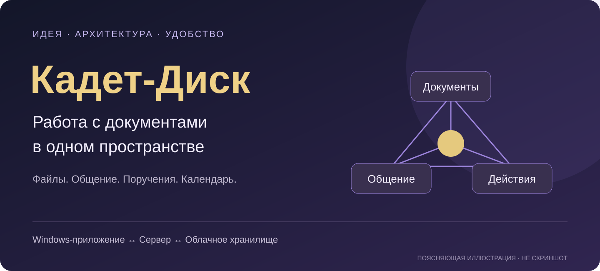
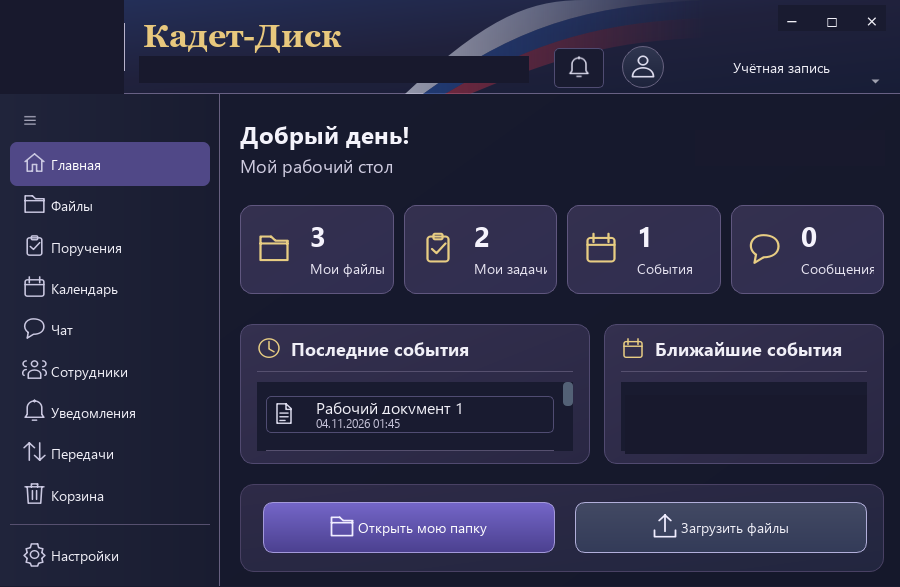
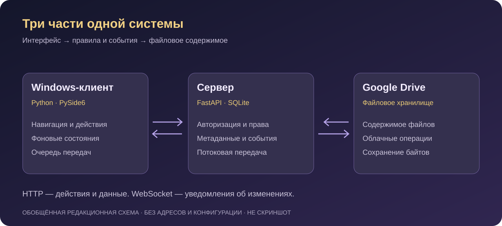
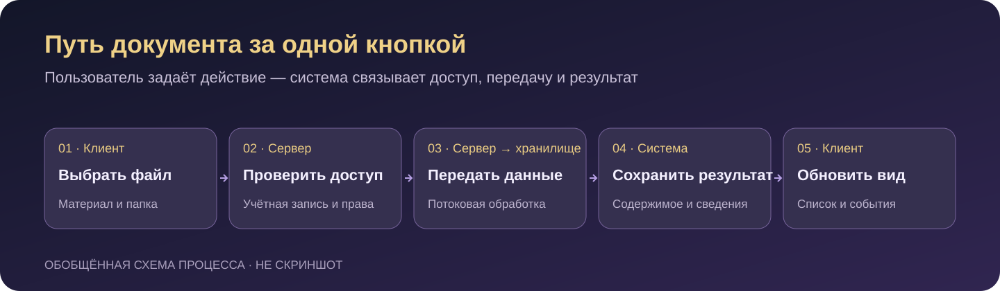
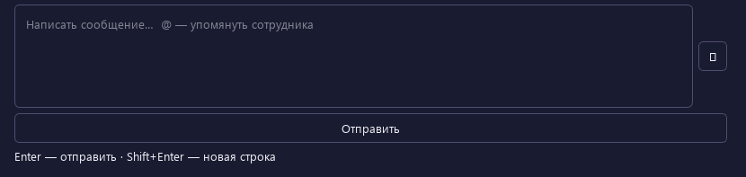
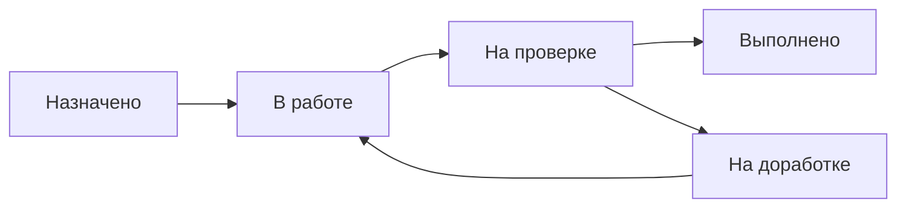
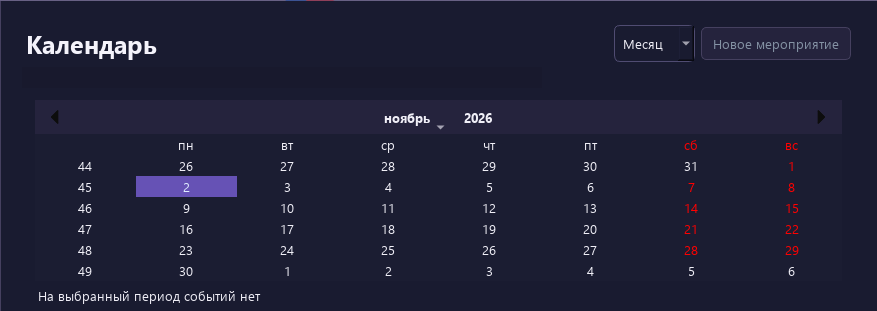

# Кадет-Диск
### Единое пространство для документов, общения и совместной работы

**Зачем создано приложение, как оно устроено и почему его возможности собраны вместе**

Документ редко существует сам по себе. Его нужно найти, передать, обсудить, изменить, согласовать с другим человеком или использовать для выполнения задачи. Рядом появляются сообщения, сроки, напоминания и новые версии. Чем больше отдельных мест участвует в этом процессе, тем труднее удерживать общую картину.

Идея «Кадет-Диска» — собрать эти действия в одном настольном приложении. Чтобы путь от «мне нужен файл» до «работа завершена» проходил через понятное пространство: с папками, поиском, перепиской, поручениями и календарём.

Эта статья — о логике продукта. О том, какие задачи он объединяет, что пользователь видит на экране и какие архитектурные решения помогают сохранять порядок за этим экраном.

---

## Содержание

- [Идея: сохранить контекст работы](#идея-сохранить-контекст-работы)
- [Первое знакомство: рабочий стол вместо лабиринта](#первое-знакомство-рабочий-стол-вместо-лабиринта)
- [Документы: привычные действия в общем пространстве](#документы-привычные-действия-в-общем-пространстве)
- [Архитектура: клиент, сервер и хранилище](#архитектура-клиент-сервер-и-хранилище)
- [Что происходит после нажатия «Загрузить»](#что-происходит-после-нажатия-загрузить)
- [Доступ: общее пространство с личными границами](#доступ-общее-пространство-с-личными-границами)
- [Общение рядом с документами](#общение-рядом-с-документами)
- [Поручения: от назначения до результата](#поручения-от-назначения-до-результата)
- [Календарь и уведомления: помнить о важном](#календарь-и-уведомления-помнить-о-важном)
- [Удобство складывается из деталей](#удобство-складывается-из-деталей)
- [Надёжность как часть повседневной работы](#надёжность-как-часть-повседневной-работы)
- [Как идея превращается в целостное приложение](#как-идея-превращается-в-целостное-приложение)
- [Один сценарий, в котором всё соединяется](#один-сценарий-в-котором-всё-соединяется)

---

## Идея: сохранить контекст работы

Представим обычную ситуацию: нужно подготовить документ, уточнить несколько деталей и передать результат. Сам файл лежит в одной папке, обсуждение идёт в другом приложении, срок записан отдельно, а подтверждение получения приходится искать в сообщениях.

Проблема здесь не только в количестве окон. Разрывается связь между действиями. Из переписки не всегда понятно, о какой версии идёт речь. Из папки не видно, что с документом нужно сделать. Полученное уведомление ещё не помогает быстро найти нужный объект.

«Кадет-Диск» соединяет несколько привычных инструментов вокруг общего процесса:

| Часть работы | Что даёт приложение |
|---|---|
| Найти материал | Папки, поиск, избранное и недавние открытия |
| Обсудить вопрос | Общий чат, личные диалоги, упоминания и вложения |
| Передать работу | Поручения, результаты и переходы между состояниями |
| Подтвердить ознакомление | Подтверждение назначенной версии документа |
| Удержать сроки | Календарь, события и уведомления |
| Понять, что происходит | Рабочий стол, состояние соединения и очередь передач |

Смысл такого объединения — сделать переходы между действиями короче. После уведомления можно перейти к доступному объекту. Для разговора с участником есть личная переписка. Документ можно связать с поручением, а срок — увидеть в календарном представлении.

При этом единое приложение не означает одинаковые права для всех. Общая среда должна показывать каждому именно ту часть данных, с которой ему разрешено работать.

## Первое знакомство: рабочий стол вместо лабиринта

*Реальный интерфейс приложения в сохранённом тестовом запуске. Идентифицирующие элементы закрыты; счётчики и документ в этом снимке демонстрационные. Оформление и расположение элементов не перерисовывались.*

Знакомство начинается с главной страницы. Она помогает ответить на два вопроса: «что требует внимания?» и «с чего начать?».

В верхней части рабочего стола расположены карточки файлов, задач, событий и сообщений. Ниже — последние изменения и ближайшие события. Внизу основной области — быстрые действия: открыть свою папку и загрузить файлы.

У такой композиции есть практический смысл. Человеку, который пришёл продолжить работу, не обязательно сначала открывать проводник, затем календарь и только потом вспоминать о поручении. Главная собирает несколько ориентиров на одном экране.

### Постоянная навигация

Слева находятся основные разделы. Файлы, поручения, календарь, общение, уведомления и передачи не прячутся внутри дерева каталогов. У них есть постоянное место в приложении.

Это разделяет две разные задачи: выбрать вид деятельности и найти объект внутри него. Сначала пользователь переходит к файлам, а затем работает с папками. При переходе к календарю ему не нужно воспринимать мероприятие как ещё один элемент файловой иерархии.

### Визуальный характер

Тёмный фон индиго, фиолетовые активные элементы, светлый текст и золотистые акценты образуют общую тему Royal Indigo. Выбранный раздел выделяется, основные действия заметны, а панели рабочего стола отделены друг от друга.

Сам по себе цвет не делает приложение удобным. Его роль — поддержать иерархию: показать, где навигация, где содержимое и какое действие доступно сейчас. Последовательность оформления помогает узнавать эти элементы при переходе между разделами.

## Документы: привычные действия в общем пространстве

*Фрагмент реального файлового интерфейса: переходы, поиск, выбор режима, загрузка, создание папки и дополнительные действия. Название рабочего пространства закрыто.*

Файловый раздел использует знакомую модель: папки, таблица документов, поиск и действия над выбранными объектами. Пользователю не нужно осваивать отдельный язык для обычной работы с файлами.

В таблице важны название, тип, размер и время изменения. Панель действий позволяет загрузить документ, создать папку, посмотреть сведения или открыть дополнительные операции. Дерево помогает ориентироваться в структуре, а переходы — возвращаться к нужному расположению.

Но общее пространство отличается от одиночной папки на компьютере. Документ может измениться, пока открыт список. Доступ может быть отозван. Файл может участвовать в поручении или быть приложен к сообщению. Поэтому за привычными командами стоит серверная проверка актуального состояния.

### Несколько путей к одному документу

Не каждый поиск начинается с воспоминания о папке. Иногда человек помнит название, иногда — фразу из содержимого, а иногда лишь то, что недавно открывал файл.

Поэтому в приложении предусмотрены разные способы возвращения к материалам:

- **Папки** — когда известно расположение.
- **Поиск файлов и папок** — когда известно название.
- **Поиск по содержимому** — когда помнится текст документа.
- **Избранное** — для того, что нужно регулярно.
- **Недавние открытия** — для продолжения начатой работы.

Избранное и история открытий относятся к конкретному пользователю. Это небольшая, но важная часть персонального рабочего пространства: общий набор документов не должен превращаться в общую историю действий всех участников.

### Поиск по содержимому

Текстовый поиск выполняется на сервере. Пользователю не требуется скачивать все документы, чтобы найти нужную фразу.

Поддерживаемые материалы включают PDF с текстовым слоем, DOCX и TXT. Здесь есть понятная граница: скан без распознанного текста не становится доступным для такого поиска автоматически. После загрузки документ также может некоторое время ожидать индексации.

Результаты поиска учитывают действующие права. Защита распространяется не только на скачивание: название и найденный фрагмент тоже не должны раскрывать недоступный документ.

### Работа с несколькими файлами

При массовой операции важен результат каждого элемента. Если часть документов обработана, а для части не хватает прав или возник конфликт, приложение должно показать это различие.

Такой подход полезнее общего сообщения «готово». Он позволяет понять, что уже сделано и к чему нужно вернуться, не повторяя весь набор действий вслепую.

## Архитектура: клиент, сервер и хранилище

*Обобщённая схема архитектуры. Это поясняющая иллюстрация, не скриншот.*

У «Кадет-Диска» три основных уровня: Windows-приложение, сервер и Google Drive. Каждый отвечает за свою часть работы.

### Windows-клиент — место взаимодействия

Клиент написан на Python с использованием PySide6. Он показывает интерфейс, принимает действия пользователя, отображает документы и сообщения, управляет фоновыми запросами и состояниями передач.

Для человека именно клиент и есть «Кадет-Диск». Поэтому от него требуется больше, чем отправить запрос. Нужно показать ожидание, сохранить понятную навигацию, сообщить об ошибке и не позволить устаревшему ответу заменить более новое состояние.

Настольный формат объединяет разные разделы в одном окне и даёт доступ к привычным действиям Windows: выбору локальных файлов, работе с папками и системному трею.

### Сервер — общие правила и состояние

Сервер построен на FastAPI и использует SQLite для прикладных данных. Он связывает учётные записи, права, метаданные документов, переписку, поручения и события.

Именно здесь принимается решение, разрешена ли операция. Клиент может скрыть недоступную кнопку, но окончательную проверку выполняет сервер. Иначе обход интерфейса позволял бы обойти и ограничения.

Центральное состояние помогает работе с нескольких компьютеров: доступ, сообщения и сведения о документах определяются учётной записью и серверными данными. При этом ранее скачанная локальная копия остаётся отдельной копией — отзыв доступа не удаляет её с чужого устройства.

### Google Drive — файловое содержимое

Google Drive хранит байты документов. Сервер связывает их с прикладными правилами, а клиент предоставляет удобный способ работы.

Это разделение принципиально. Хранилище отвечает за содержимое, а приложение — за смысл: кому доступен файл, к какому действию он относится и какое состояние необходимо показать.

Изменение поручения не требует переписывать сам документ. Изменение прав не должно требовать создания новой копии файла. Для каждого действия используется тот уровень, которому оно принадлежит.

### Запросы и события

HTTP используется для получения данных и выполнения действий. WebSocket помогает сообщать об изменениях без постоянного ручного обновления всех разделов.

Событие служит сигналом: появилась новая информация, нужно обновить соответствующее представление. При этом оно не отменяет проверку доступа. Пользователь получает актуальные разрешённые данные, а не безусловно доверяет любому ранее полученному сообщению.

## Что происходит после нажатия «Загрузить»

За одной кнопкой находится цепочка действий, которую пользователь не обязан выполнять вручную.

*Поясняющая схема пути документа, не изображение интерфейса.*

Сначала человек выбирает локальный файл и место назначения. Клиент подготавливает передачу, а сервер проверяет учётную запись, папку и разрешение на операцию.

Затем содержимое проходит через сервер к хранилищу. Для крупных файлов используется потоковая обработка: передача не требует собирать весь документ в оперативной памяти сервера только ради пересылки.

После успешной операции обновляются сведения об объекте. Заинтересованные клиенты получают сигнал об изменении и могут обновить соответствующий список.

### Почему важна очередь передач

Очередь позволяет отделить работу с приложением от ожидания сети. Пока файл передаётся, человек может ориентироваться в интерфейсе и видеть состояние операции.

Если связь прервалась, полезно работать с уже существующей передачей: посмотреть её состояние, отменить или выполнить управляемый повтор. Бесконтрольное создание новых загрузок затрудняло бы понимание результата и могло бы приводить к дублированию.

### Почему недостаточно показать сто процентов

Процент передачи описывает лишь часть процесса. Документ должен соответствовать ожидаемому размеру и содержимому, а его итоговое состояние — согласовываться с метаданными.

Отдельного внимания требуют продолжение скачивания, проверка целостности и конфликт версии. Если за время работы появился более новый вариант, система не должна незаметно затереть его устаревшим результатом.

Для пользователя всё это выражается просто: понятное завершение, понятная ошибка и возможность продолжить работу без догадок.

## Доступ: общее пространство с личными границами

В совместной системе открытость и приватность должны существовать одновременно. Общие материалы нужны для взаимодействия, а личные папки — для работы, которая не должна становиться видимой всем автоматически.

Поэтому доступ относится к конкретным объектам и действиям. Возможность увидеть папку не равна праву изменить всё, что в ней находится. Возможность отправить сообщение не означает возможность выдать получателю доступ к любому приложению.

| Где может раскрыться информация | Что необходимо учитывать |
|---|---|
| Список файлов | Доступность самого объекта |
| Поиск | Право видеть название и фрагмент текста |
| Сообщение с вложением | Право получателя открыть документ |
| Общая активность | Допустимость показа действия и расположения |
| Уведомление | Актуальный доступ при переходе |
| Ранее открытое окно | Изменение прав после его открытия |

Общая лента особенно показательна. Даже если закрытый документ не виден в проводнике, его название не должно появиться в событии о переименовании или загрузке.

В «Кадет-Диске» личные папки исключаются из общего журнала. Для сомнительных старых событий отсутствие доказуемо безопасного расположения не трактуется как разрешение на публикацию.

Такая архитектура делает границы доступа частью всей системы, а не отдельной настройкой файлового раздела.

## Общение рядом с документами

Обсуждение — естественное продолжение работы с файлом. Можно уточнить вопрос, обратить внимание на изменение, передать материал и вернуться к его обработке.

Приложение включает общий чат и личные диалоги. Общий канал подходит для вопросов, относящихся ко всем его участникам. Личная переписка помогает продолжить разговор с конкретным человеком без переноса всей темы в общий поток.

Из списка участников предусмотрен переход к личному диалогу. Для пользователя это короткий маршрут: найти человека и начать общение.

*Фрагмент реального редактора общего чата: поле сообщения, упоминание, отправка и подсказка клавиатурных действий. Переписка не публикуется.*

### Упоминания и реакции

Упоминание выделяет адресата внутри разговора. Реакция позволяет коротко ответить на сообщение без отдельной реплики, а библиотека эмодзи делает выбор доступным из интерфейса.

У этих небольших функций тоже есть прикладной смысл. Короткая реакция уменьшает число однотипных сообщений, а упоминание помогает человеку заметить обращённый к нему вопрос.

### Вложения из двух источников

Файл можно выбрать на компьютере или внутри доступного пространства «Кадет-Диска». Во втором случае важно сохранять связь с существующим объектом там, где это безопасно, вместо появления неясных дубликатов.

Но удобство выбора не должно подменять права. Получатель вложения по-прежнему должен иметь разрешение на документ. Переписка связывает участников и материалы, сохраняя границы доступа к ним.

## Поручения: от назначения до результата

Переслать документ — ещё не значит договориться о дальнейшей работе. Для поручения нужны действие, ответственный участник, срок и понятное состояние.

Приложение разделяет назначение, начало работы, передачу результата на проверку и завершение.

*Схема процесса, не скриншот.*

Когда начало работы является отдельным действием, становится понятнее, что происходит с задачей. Передача результата на проверку также отличается от окончательного завершения: проверяющий может принять работу или вернуть её с замечанием.

Это помогает избежать ситуации, когда у отправителя и исполнителя разные представления о готовности. Одному кажется, что результат уже сдан; другому — что исправления ещё ожидаются. Состояния делают этот переход явным.

### Ознакомление — отдельный процесс

Подтверждение ознакомления относится к назначенной версии документа. Оно отвечает на другой вопрос: конкретный участник подтвердил получение именно этого материала?

Если документ назначен нескольким людям, первый ответ не закрывает назначения остальных. Каждое подтверждение сохраняет собственный смысл.

Разделение поручения и ознакомления делает приложение понятнее. Не всякий документ требует исполнения задачи, и не всякое прочтение означает выполнение работы.

## Календарь и уведомления: помнить о важном

Календарь нужен для обзора времени: увидеть событие, срок и связь с предстоящими действиями.

*Фрагмент реального календарного раздела. Контекстная подпись закрыта; выбранный период в исходном снимке не содержит событий.*

У календаря есть два разных режима восприятия: что предстоит и что уже произошло. Завершённое или отменённое мероприятие не должно продолжать выглядеть новым, но и исчезать из истории ему не следует.

В приложении предусмотрены актуальные события и история. Это позволяет вернуться к прошлой записи, сохраняя чистоту обзора ближайших дел.

### Уведомление должно вести к действию

Полезное уведомление сообщает об изменении и помогает продолжить работу. После нажатия важно попасть в соответствующую карточку или к доступному документу.

Если объект перемещён, его прежний путь может устареть. Поэтому связь с объектом важнее запомненной строки расположения. Если объект удалён, доступная папка может остаться полезной точкой перехода.

Уведомления собираются во встроенной панели. Группирование массовых событий помогает не превращать серию однотипных действий в длинную неразличимую ленту.

### События и внимание

Не каждое изменение требует одинаковой реакции пользователя. Сообщение, упоминание, документ, поручение и мероприятие относятся к разным ситуациям.

Различение категорий, непрочитанные состояния и настройки звука помогают управлять вниманием. Их цель — сделать важное заметным и при этом сохранить возможность спокойно работать с основным содержимым.

## Удобство складывается из деталей

Удобство приложения редко определяется одной большой функцией. Чаще оно складывается из последовательности небольших решений, которые уменьшают количество лишних действий.

### Быстро вернуться к работе

Избранное удерживает постоянные материалы под рукой. Недавние открытия помогают продолжить вчерашний документ. Быстрый переход в свою папку избавляет от повторного обхода дерева.

Каждый из этих путей решает отдельный случай. Вместе они позволяют не начинать поиск заново при каждом входе.

### Не заставлять ждать весь интерфейс

Работа с сетью требует фоновых операций. Медленный ответ хранилища не должен превращаться в ощущение, что всё приложение перестало отвечать.

Кэширование и объединение повторяющихся запросов помогают избегать лишних обращений. Но старые данные не должны получать приоритет перед новыми ответами сервера или изменившимися правами.

### Показывать честное состояние

«Подключено», «нет соединения», «идёт передача» и «нужен повтор» означают разные ситуации. Они помогают выбрать следующее действие.

Если сведений пока нет, неизвестное значение не следует выдавать за подтверждённый ноль. Если сеть недоступна, пользователю важно понимать причину ожидания, а не гадать, завершилась ли операция.

### Сохранять привычное поведение

Выбор нескольких элементов, контекстные действия, поиск, Enter для отправки и Shift+Enter для новой строки используют знакомые модели взаимодействия.

Пользователь тратит меньше внимания на управление инструментом и больше — на саму работу. Для приложения, к которому возвращаются постоянно, это один из главных критериев качества.

## Надёжность как часть повседневной работы

Надёжность проявляется в обычных ситуациях: соединение оборвалось, приложение закрыли, документ изменился на другом компьютере, а право доступа стало другим.

### Сохранённый вход

Запоминание устройства должно упрощать возвращение в приложение, сохраняя проверку сессии. При этом явный выход или забывание устройства не должны отменяться поздним ответом фонового запроса.

Для человека это выглядит как спокойный повторный запуск. Внутри требуется согласовать состояние клиента и сервера.

### Переподключение

После разрыва связи важно восстановить не только сам канал, но и актуальные данные. Сообщения, счётчики и доступы должны соответствовать текущему серверному состоянию.

Проверки таких сценариев помогают сделать поведение предсказуемым. Они не превращают любую сеть в безотказную, но позволяют корректнее переживать её обычные сбои.

### Обновление приложения

Пользователю нужен понятный путь: проверить наличие обновления, скачать его и установить с перезапуском.

Внутри этот путь включает доверенные метаданные, проверку подписи и контроль целостности. Используется цепочка TUF, а предыдущий выпуск сохраняется для предусмотренного механизма возврата.

Обновление — часть продукта: после него важно продолжить работу с прежним профилем и данными, а не заново настраивать среду.

### Сохранность данных

Резервирование проверяется возможностью восстановления в отдельной среде. При этом база приложения и байты облачных документов — разные объекты сохранности; копия одного не заменяет полноценную копию другого.

В разработке также проверяются соответствие собранного клиента исходникам, установка обновления и сохранение контрольных данных. Эти проверки поддерживают возможность развивать приложение без потери уже работающих сценариев.

## Как идея превращается в целостное приложение

Развитие «Кадет-Диска» можно описать через последовательное расширение самой задачи.

**Сначала — доступ к документам.** Нужны приложение, сервер, папки и понятный способ передать файл.

**Затем — удобство повторной работы.** Появляется потребность быстро находить материалы, возвращаться к недавно открытому и выполнять действия сразу над несколькими объектами.

**Следующий слой — взаимодействие.** Документы связываются с сообщениями, вложениями, поручениями и ознакомлением.

**Далее — общий обзор.** Рабочий стол, календарь и уведомления помогают видеть работу целиком, не обходя каждый раздел отдельно.

**И постоянно — устойчивость.** По мере роста возможностей становятся важнее сессии, права, конфликты версий, переподключение, скорость запросов и установка обновлений.

Это не календарный список выпусков. Это логика превращения идеи файлового пространства в связанное приложение. Каждое новое направление должно вписываться в общие правила, иначе вместо единого инструмента получится набор отдельных экранов.

## Один сценарий, в котором всё соединяется

Рассмотрим условный рабочий сценарий — без реальных людей и документов.

Пользователь открывает приложение и видит рабочий стол. Он переходит к нужному материалу через избранное или поиск, уточняет вопрос в личной переписке и прикладывает доступный документ.

Полученное поручение нужно явно взять в работу. Когда результат готов, его можно передать на проверку. Если требуется уточнение, работа возвращается на доработку; после принятия состояние меняется на завершённое.

Срок остаётся частью процесса, а уведомление помогает вернуться к связанному действию. Если передача файла прерывается, её состояние можно проверить в очереди. Если документ нужен снова, недавние открытия сокращают путь к нему.

Здесь нет единственной «волшебной» функции. Удобство возникает из того, что разные действия соединены общей учётной записью, понятной навигацией и одной моделью доступа.

---

## Что получилось

«Кадет-Диск» объединяет файловое пространство, общение и организацию работы в самостоятельном Windows-приложении.

Его архитектура распределяет обязанности: клиент отвечает за взаимодействие, сервер — за правила и прикладное состояние, хранилище — за содержимое документов. Интерфейс собирает эти уровни в понятные человеку действия.

Главная идея остаётся простой: **нужный материал, связанный разговор и следующий шаг должны находиться достаточно близко, чтобы работа не теряла свой контекст.**

---

В статье использованы настоящие сохранённые изображения приложения, обезличенные и местами обрезанные для читаемости. Это не новые снимки текущего сеанса. Интерфейс не генерировался и не перерисовывался. Схемы явно отделены от скриншотов. Обстоятельства создания и участники не раскрываются. [Об источниках и иллюстрациях](EDITORIAL.md).
